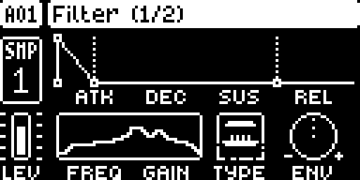
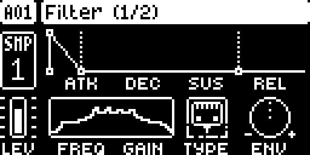
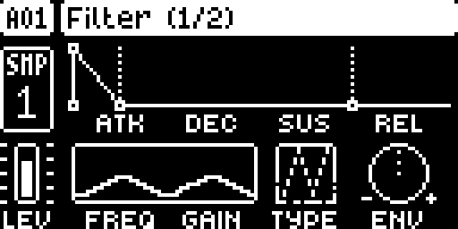
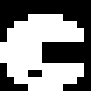
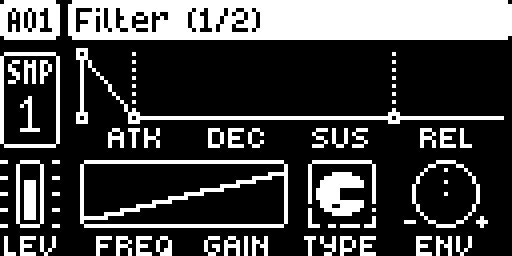
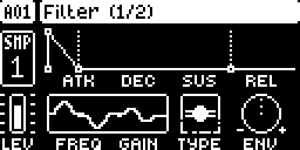
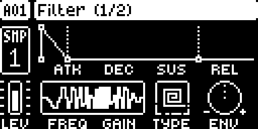
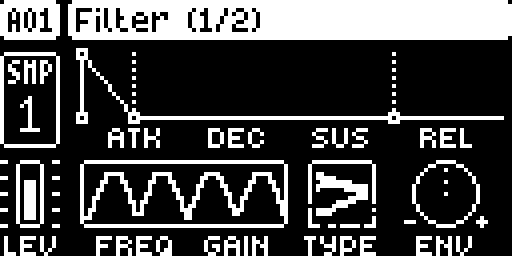

# Filter+FX

**Filter+FX** is a standalone [elekloader](https://github.com/irpina/elekloader)
mod for the **Elektron Digitakt mk1**. It adds seven per-track filter/FX modes
alongside the stock filter, each using the track's own **FREQ**, **RESO** and
filter envelope. The FLTR page is redrawn with a custom TYPE-box icon and a
dedicated graph for every mode.

| TYPE | mode | controls |
|---|---|---|
| **8** | **VOWEL** | FREQ = vowel path i-e-a-o-u; RESO = formant width |
| **9** | **BANK** | FREQ = bank shift; RESO = Q |
| **10** | **FOLD** | FREQ = drive 1–8×; RESO = fold bias |
| **11** | **CRUSH** | FREQ = sample-hold rate; RESO = bit depth |
| **12** | **RING** | FREQ = carrier frequency; RESO = dry/ring depth |
| **13** | **PHASER** | FREQ = LFO rate; RESO = depth |
| **14** | **FLANGER** | FREQ = LFO rate; RESO = depth/feedback |

## Screenshots

Every shot is the real FLTR page from digiemu, not a mock-up.

| mode | icon | FLTR page |
|---|---|---|
| VOWEL |  |  |
| BANK |  |  |
| FOLD |  |  |
| CRUSH |  |  |
| RING |  |  |
| PHASER |  |  |
| FLANGER |  |  |

## Notes

- **VOWEL** is SynVOW's FormantEngine model: F1–F3 from the male vowel table
  plus a fixed F4 at 3300 Hz, blended in the log-frequency domain.
- **BANK** is four fixed resonators at 250/500/1000/2000 Hz, shifted together.
- **FOLD** is a triangle folder; **CRUSH** is sample-rate reduction + 1–16 bit
  quantisation.
- **RING** is a sine carrier ring modulator.
- **PHASER** is four cascaded first-order allpasses with an LFO.
- **FLANGER** is a short LFO-modulated fractional delay with feedback.
- The stock filter envelope moves the FREQ position, so it also modulates the
  vowel position, bank shift, fold drive, crush rate, ring frequency and the
  phaser/flanger LFO rate.
- Stock TYPE 0–7 still run the stock filter and keep the stock curve.

## Cost

Per voice per 32-frame block (MCF54418, `tests/analog_bench.py`):

| mode | static | swept | vs stock (static / swept) |
|---|---|---|---|
| VOWEL | 3042 / ~3455 cyc | 5011 / ~6176 cyc | **+27 % / +109 %** |
| BANK | 3042 / ~3455 | 5017 / ~6187 | **+27 % / +109 %** |
| FOLD | 451–547 / ~560–800 | same | **‑77…‑81 %** |
| CRUSH | 406 / ~512 | same | **‑83 %** |
| RING | 666 / ~930 | same | **‑72 %** |
| PHASER | 2583 / ~3700 | same | **+8 %** |
| FLANGER | 1794 / ~2180 | same | **‑25 %** |
| stock filter (reference) | ~2400 insn | — | 1.00× |

The `vs stock` column compares instructions per voice/block with the stock
filter (~2400). VOWEL/BANK use four independent biquads, one eMAC accumulator
per band. FOLD/CRUSH/RING/PHASER/FLANGER have no coefficient ramp. FLANGER
allocates 512 samples per voice (16 KB).

## Build

```sh
export PATH="<m68k-elf bin>:$PATH"
export ELEKLOADER_CROSS=m68k-elf-
export PYTHONPATH="<elekloader checkout>"

python -m elekloader.sdk.build . --stock <Digitakt_OS1.53.syx>
python -m elekloader.lint  out/filter-fx-1.0c.elemod \
    --stock <Digitakt_OS1.53.syx> --with <core.elemod>
```

`mod.json` also carries the OS 1.54 port; use the 1.54 stock with an
elekloader that supports it.

## Install

```sh
python -m elekloader.patch --stock Digitakt_OS1.53.syx \
    --mod core-2.1.elemod --mod out/filter-fx-1.0c.elemod \
    --out Digitakt_OS1.53-filter-fx.syx --version 2.0t
```

Then flash the `.syx` with Elektron Transfer.

## Sources

| file | |
|---|---|
| `filter.c` | the seven models, biquad ramps and the per-voice entry |
| `biquad_dsp.s` | four independent biquads in one eMAC pass |
| `filter_glue.s` | TYPE label formatter and per-voice dispatch |
| `filter_ui.c` | response/transfer/modulation graphs and the TYPE-box art |
| `biquad_tables.h` | RBJ band-pass coefficients, Q30 (`tools/gen_biquad_tables.py`) |
| `analog_tables.h` | vowel formant positions and bank centres (`tools/gen_analog_tables.py`) |
| `mod_tables.h` | sine/LFO/ring-mod tables (`tools/gen_mod_tables.py`) |
| `tests/analog_bench.py` | instruction/cycle bench |
| `tests/analog_smoke.py` | bounded/non-silent check for all modes |
| `tests/digiemu_filter_fx_shots.py` | regenerates the screenshots above |

## Licensing

Filter+FX is GPL-2.0-or-later. The code is derived from DigiFilter; the VOWEL
formant data is SynVOW's own work, used with permission. The Digitakt
screenshots remain Elektron's. See [THIRD_PARTY.md](THIRD_PARTY.md) for the full
notice.

## Credits

- **Digital Alchemy DSP** — the mod, the SVF/biquad kernels and the Digitakt UI.
- The formant model is adapted from **SynVOW**'s `FormantEngine`
  (ER-301 MouthTowel lineage).
- **Simon Johansson** — the Oberheim OB-1 modes in the parent DigiFilter, whose
  fixed-point/assembly patterns this fork reuses.

No Elektron firmware is included. GPL-2.0-or-later; see `LICENSE`.
